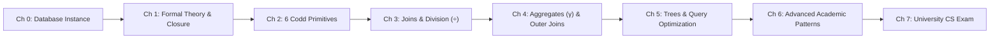

# Relational Algebra (Databases) Masterclass

A rigorous, university Computer Science level curriculum and interactive laboratory on **Relational Algebra (RA)**, formal database query semantics, and algebraic query optimization.

Built from the ground up on Edgar F. Codd’s foundational relational model (1970) and grounded in a concrete, fully instantiated academic database.

---

## 📚 Curriculum Structure

The course is organized into structured, sequential textbook chapters under [`curriculum/`](curriculum/):

| Chapter | Title | Focus & Core Content |
| :---: | :--- | :--- |
| **00** | [**Instantiated Model & Dataset**](curriculum/00_instantiated_model_and_dataset.md) | Formal domains, relations, superkeys, candidate keys, and the canonical 6-relation benchmark database (`Student`, `Course`, `Enrollment`, `Instructor`, `Teaches`, `Prereq`). |
| **01** | [**Formal Foundations**](curriculum/01_formal_foundations.md) | What is an algebra? The Closure Property, procedural vs. declarative paradigms, Relational Completeness, Codd's Theorem, and internal RDBMS query lifecycles. |
| **02** | [**Codd's Fundamental Primitives**](curriculum/02_fundamental_operators.md) | The 6 atomic primitives: Selection ($\sigma$), Projection ($\pi$), Cross Product ($\times$), Rename ($\rho$), Union ($\cup$), Difference ($-$). Shows **immediate compoundings** ($\pi(\sigma(R))$, Cartesian + Selection $\implies$ Join, Self-Joins). |
| **03** | [**Derived Operators (Joins & Division)**](curriculum/03_derived_operators.md) | Theta-Join ($\bowtie_\theta$), Equi-Join, Natural Join ($\bowtie$), Intersection ($\cap$), Semi-Join ($\ltimes$), Anti-Join ($\triangleright$), and an exhaustive step-by-step derivation of the **Relational Division operator ($\div$)** for universal quantification ($\forall$). |
| **04** | [**Extended Relational Algebra**](curriculum/04_extended_relational_algebra.md) | Generalized Projection ($\pi_{\text{expr}}$), Grouping & Aggregations ($_{G}\gamma_F$), Left/Right/Full Outer Joins ($\mathbin{⟕}, \mathbin{⟖}, \mathbin{⟗}$), Three-Valued Logic (3VL), and null value semantics. |
| **05** | [**Expression Trees & Optimization**](curriculum/05_algebraic_optimization_and_query_trees.md) | Operator trees, algebraic equivalence laws, heuristic query rewrites, **Predicate Pushdown**, and cardinality estimation analysis. |
| **06** | [**Academically Important Scenarios**](curriculum/06_academically_important_scenarios.md) | Finding maximum/extreme values **without** aggregation, counting without `COUNT` (At-least-$k$ vs. Exactly-$k$), exclusive non-association ("A and NOT B"), and the theoretical limit of Relational Algebra: Transitive Closure. |
| **07** | [**University CS Final Exam & Solutions**](curriculum/07_university_exam_and_solutions.md) | A complete 100-point university examination covering theory, manual table evaluation, query formulations, optimization proofs, and an exhaustive step-by-step grading rubric. |
| **Ref** | [**Quick Reference Cheatsheet**](curriculum/quick_reference_cheatsheet.md) | Symbols, ASCII equivalents, operator precedence, optimizer rules, and SQL translation reference table. |

---

## ⚡ The Interactive Learning Lab

Located in [`interactive-lab/`](interactive-lab/), this zero-dependency web application provides a browser-based visual laboratory:

- 🗄️ **Schema Explorer:** Live inspection of all relations, keys, types, and tuples.
- ⚡ **Operator Workbench:** Real-time evaluator with presets covering Selection, Projection, Joins, Division, Anti-Joins, and Aggregations with full step-by-step intermediate table traces.
- 🌳 **Query Tree Visualizer & Optimizer:** Side-by-side comparison of naive vs. optimized algebraic plans with node graphs and intermediate memory savings calculations.
- 🔬 **Academic Scenarios Deep Dive:** Step-by-step breakdowns of tricky patterns (Division, Max without aggregates, Counting without count).
- 📝 **University CS Exam Simulator:** 10 interactive exam problems with instant evaluation, score tracking (0–100 pts), pedagogical hints, and full CS derivations.

### How to Launch the Interactive Lab:

#### Option 1: Direct Browser File Launch
Open [`interactive-lab/index.html`](interactive-lab/index.html) directly in any modern web browser (Chrome, Firefox, Safari, Edge). All data and logic are embedded with zero CORS restrictions.

#### Option 2: Local HTTP Server (Terminal)
```bash
cd interactive-lab
python3 -m http.server 8080
```
Then navigate to `http://localhost:8080` in your browser.

---

## 💻 Python CLI Evaluator (`ra_cli.py`)

A pure Python reference implementation of Relational Algebra is included in [`ra_cli.py`](ra_cli.py).

### Run Demonstrations:
```bash
python3 ra_cli.py
```
This executes and displays colored terminal tables for:
1. Selection + Projection compounding
2. Natural Join
3. Relational Division (Finding Alice who took all CS courses)
4. Highest-paid instructor without `MAX()`
5. Left Outer Join with dangling tuple preservation (Fiona)

---

## 🎯 Learning Roadmap & Recommended Study Flow



1. **Phase 1 (Foundations):** Read Chapters 0 & 1, then open the Interactive Lab to familiarize yourself with the University database.
2. **Phase 2 (Core Mechanics):** Work through Chapters 2 & 3. Test each operator and compounding pattern in the Workbench tab.
3. **Phase 3 (Extensions & Systems):** Study Chapters 4 & 5 to understand how RDBMS engines optimize queries with Predicate Pushdown.
4. **Phase 4 (Mastery & Assessment):** Work through Chapter 6's edge cases, then take the exam in Chapter 7 and the Interactive Exam tab.
