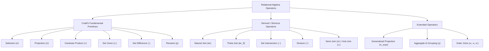

# Chapter 1: Formal Foundations of Relational Algebra

## 1. What is Relational Algebra?

**Relational Algebra (RA)** is a formal mathematical query language that provides an operational, step-by-step foundation for data retrieval in the relational model. Formulated by Edgar F. Codd in 1970, RA defines a set of operations that take one or more relations as input and produce a new relation as output.

### The Algebraic Structure
In abstract algebra, an algebraic system consists of a set of elements (the domain) closed under one or more operators.
In Relational Algebra:
- **Operands:** Relations (sets of tuples conforming to a schema).
- **Operators:** Unary and binary functions ($\sigma, \pi, \times, \cup, -, \rho$, etc.).
- **Evaluation Result:** A relation.

```
Input Relation(s)  ───► [ Relational Operator ] ───► Output Relation
     (Schema A)                                          (Schema B)
```

---

## 2. The Closure Property (Why It Matters)

> [!IMPORTANT]
> **The Closure Property:** The result of any relational algebra operation on relations is itself a relation.

Because every operator yields a well-formed relation conforming to a schema:
1. **Arbitrary Nesting / Composition:** The output of one operation can immediately serve as the input to another operation:
   $$\pi_{\text{name}}\left(\sigma_{\text{gpa} > 3.5}(\text{Student})\right)$$
2. **Expression Trees:** Any complex RA query can be modeled as a directed acyclic tree (operator tree) of algebraic transformations.
3. **Algebraic Rewriting:** Queries can be legally transformed into mathematically equivalent trees with drastically different computational performance (the basis of all RDBMS query optimizers).

---

## 3. Procedural vs. Declarative: RA vs. Relational Calculus & SQL

Computer Science distinguishes two primary paradigms for querying relational databases:

| Dimension | Relational Algebra (RA) | Tuple/Domain Relational Calculus (TRC/DRC) | Structured Query Language (SQL) |
| :--- | :--- | :--- | :--- |
| **Paradigm** | **Procedural** (Operational) | **Declarative** (Descriptive) | **Declarative** (Standardized) |
| **Philosophy** | *How* to compute the result: specifies exact order of operators. | *What* conditions the result tuples must satisfy, without steps. | *What* data is desired (`SELECT ... FROM ... WHERE ...`). |
| **Mathematical Basis** | Set operations, algebraic functions. | First-order predicate logic ($\forall, \exists, \land, \lor, \neg$). | Syntactic realization of both RA and Calculus concepts. |
| **Role in Systems** | Internal execution plan / Intermediate Representation (IR). | Theoretical specification. | External user interface. |

### Codd's Completeness Theorem (1972)
A query language is declared **Relationally Complete** if and only if it is at least as expressive as first-order Tuple Relational Calculus (restricted to safe queries).
Codd proved that the basic set of Relational Algebra operations ($\sigma, \pi, \times, \cup, -$) possesses exactly the same expressive power as safe first-order queries.

---

## 4. Operator Taxonomy

Relational Algebra operators are categorized by their algebraic primitives vs derived shortcuts:



### The Minimality of Primitives
None of the 5 core primitives ($\sigma, \pi, \times, \cup, -$) can be expressed using the remaining four.
- $\sigma$ filters rows without modifying columns.
- $\pi$ eliminates columns without filtering predicates.
- $\times$ pairs tuples from two disjoint schemas, expanding arity.
- $\cup$ combines tuples from union-compatible schemas.
- $-$ removes tuples present in another relation (introducing negation).

Rename ($\rho$) is added formally to disambiguate identical attribute names (especially in self-joins and cross products).

---

## 5. How Relational Database Engines Use RA Internally

When you execute an SQL query in PostgreSQL, SQLite, or Oracle, the engine performs the following lifecycle:

1. **Parser & Lexer:** Converts SQL text into an Abstract Syntax Tree (AST).
2. **Translator:** Translates the declarative SQL AST into an initial **Relational Algebra Expression Tree**.
3. **Query Optimizer:** Applies algebraic rewrite rules (e.g., pushing $\sigma$ down through $\bowtie$) to generate equivalent candidate trees and chooses the plan with the lowest estimated cost.
4. **Code Generation / Execution Engine:** Maps algebraic operators to physical algorithms (e.g., Hash Join, B-Tree Index Scan, Nested Loop) and iterates over rows.

Understanding Relational Algebra is therefore understanding the **logical machine code** of every modern database engine.
