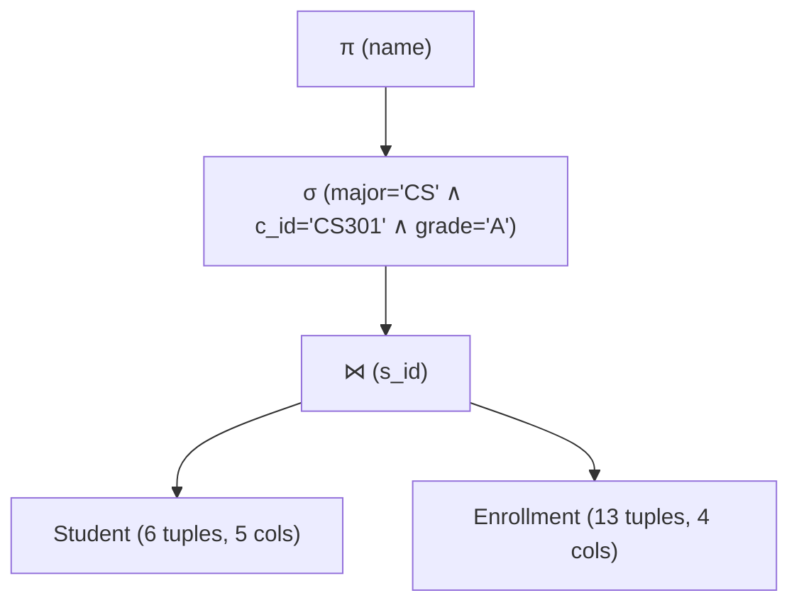
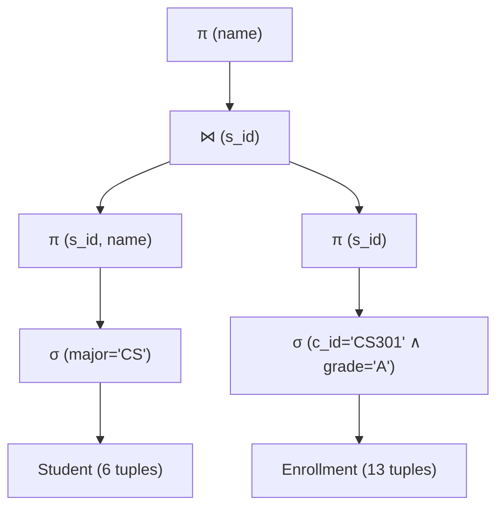

# Chapter 5: Relational Algebra Trees & Query Optimization

A major reason Computer Science values Relational Algebra is that it provides the **formal mathematical grammar for query optimization**. Every relational database engine converts declarative SQL queries into Relational Algebra Expression Trees, rewrites them using equivalence laws, and produces an optimal physical execution plan.

---

## 1. Relational Algebra Expression Trees

An **Algebraic Operator Tree** represents an algebraic expression hierarchically:
- **Leaf Nodes:** Base relations ($R, S$).
- **Internal Nodes:** Relational operators ($\sigma, \pi, \bowtie, \times, \cup$).
- **Root Node:** Final query result.
- **Data Flow:** Bottom-up (tuples flow from leaves, through intermediate operations, to the root).

---

## 2. Core Algebraic Equivalence Laws

Two relational algebra expressions $E_1$ and $E_2$ are **equivalent** ($E_1 \equiv E_2$) if they yield the exact same instance relation on every valid database state conforming to the schema.

### 2.1 Cascade of Selections
A complex conjunction of selection predicates can be decomposed into a sequence of unary selections:

$$\sigma_{c_1 \land c_2 \land \dots \land c_n}(R) \equiv \sigma_{c_1}(\sigma_{c_2}(\dots (\sigma_{c_n}(R))\dots))$$

### 2.2 Commutativity of Selections
The order of independent selections is irrelevant:

$$\sigma_{c_1}(\sigma_{c_2}(R)) \equiv \sigma_{c_2}(\sigma_{c_1}(R))$$

### 2.3 Cascade of Projections
In a sequence of projections, only the outermost projection is necessary:

$$\pi_{L_1}(\pi_{L_2}(\dots(\pi_{L_n}(R))\dots)) \equiv \pi_{L_1}(R) \quad (\text{where } L_1 \subseteq L_2 \subseteq \dots \subseteq L_n)$$

### 2.4 Commutativity of Joins and Cross Products
$$R \times S \equiv S \times R \qquad R \bowtie S \equiv S \bowtie R$$
$$(R \bowtie S) \bowtie T \equiv R \bowtie (S \bowtie T)$$

### 2.5 Pushing Selections Down Through Joins (Predicate Pushdown)
If predicate $c$ references **only** attributes belonging to relation $R$:

$$\sigma_c(R \bowtie S) \equiv \sigma_c(R) \bowtie S$$

If predicate $c = c_1 \land c_2$, where $c_1$ references only attributes of $R$, and $c_2$ references only attributes of $S$:

$$\sigma_{c_1 \land c_2}(R \bowtie S) \equiv \sigma_{c_1}(R) \bowtie \sigma_{c_2}(S)$$

> [!IMPORTANT]
> **Why Predicate Pushdown is the #1 Optimization in RDBMS:**
> A Join between relation $R$ ($N$ tuples) and relation $S$ ($M$ tuples) has worst-case complexity $\mathcal{O}(N \times M)$.
> By applying $\sigma$ *before* the join, we reduce $N$ and $M$ to tiny fractions, drastically shrinking intermediate memory consumption and comparisons!

### 2.6 Pushing Projections Down Through Joins
Let $L$ be the set of attributes required at the root. We can project early by retaining only the attributes in $L$ plus whatever join attributes are needed for the join:

$$\pi_L(R \bowtie S) \equiv \pi_L\left( \pi_{L_R \cup \text{JoinAttrs}}(R) \bowtie \pi_{L_S \cup \text{JoinAttrs}}(S) \right)$$

---

## 3. Concrete Optimization Case Study on the University Database

### Target English Query:
*"Find the names of all CS students who earned an 'A' in course CS301."*

---

### Phase A: Unoptimized (Naive) Query Plan

A naive translation of the query joins entire tables first, filters second, and projects last:

$$\text{Plan}_{\text{naive}} = \pi_{\text{name}}\left( \sigma_{\text{major} = \text{'CS'} \land \text{c\_id} = \text{'CS301'} \land \text{grade} = \text{'A'}}\left( \text{Student} \bowtie \text{Enrollment} \right) \right)$$

#### Cost Analysis of Naive Plan:
1. Join $\text{Student} \bowtie \text{Enrollment}$:
   - Compares 6 student tuples against 13 enrollment tuples.
   - Materializes an intermediate relation of **13 joined tuples**, each containing 8 columns ($13 \times 8 = 104$ data cells).
2. Filter:
   - Scans all 13 joined tuples to evaluate the 3-part compound condition.
   - Result: 1 tuple (`Alice`).
3. Project:
   - Discards 7 columns $\implies$ `Alice`.

---

### Phase B: Optimized Query Plan (Applying Rewrite Rules)

We apply the heuristic optimization pipeline:
1. **Rule 1 (Cascade):** Split selection into $c_1: (\text{major} = \text{'CS'})$ and $c_2: (\text{c\_id} = \text{'CS301'} \land \text{grade} = \text{'A'})$.
2. **Rule 2 (Pushdown $\sigma_1$):** $c_1$ references only `Student` attributes $\implies$ push directly onto `Student`.
3. **Rule 3 (Pushdown $\sigma_2$):** $c_2$ references only `Enrollment` attributes $\implies$ push directly onto `Enrollment`.
4. **Rule 4 (Pushdown $\pi$):** Project out unneeded attributes (`year`, `gpa`, `semester`) prior to the join.

$$\text{Plan}_{\text{optimized}} = \pi_{\text{name}}\left( \pi_{\text{s\_id, name}}(\sigma_{\text{major} = \text{'CS'}}(\text{Student})) \bowtie \pi_{\text{s\_id}}(\sigma_{\text{c\_id} = \text{'CS301'} \land \text{grade} = \text{'A'}}(\text{Enrollment})) \right)$$

#### Execution on Instantiated Data:
1. **Left Branch:**
   - $\sigma_{\text{major} = \text{'CS'}}(\text{Student}) \implies \{\text{s1}, \text{s2}, \text{s5}\}$ (3 tuples).
   - $\pi_{\text{s\_id, name}} \implies \{(\text{s1, Alice}), (\text{s2, Bob}), (\text{s5, Evan})\}$ (3 tuples, 2 cols).
2. **Right Branch:**
   - $\sigma_{\text{c\_id} = \text{'CS301'} \land \text{grade} = \text{'A'}}(\text{Enrollment}) \implies \{(\text{s1, CS301, S24, A})\}$ (1 tuple).
   - $\pi_{\text{s\_id}} \implies \{(\text{s1})\}$ (1 tuple, 1 col).
3. **Join:**
   - Compares only 3 tuples against 1 tuple!
   - Intermediate joined size: **1 tuple** of 2 columns!
4. **Final Project:**
   - Yields `Alice`.

### Comparison Summary:
| Metric | Naive Query Plan | Optimized Query Plan |
| :--- | :--- | :--- |
| Intermediate Join Size | 13 tuples $\times$ 8 columns = 104 cells | 1 tuple $\times$ 2 columns = 2 cells |
| Tuples compared in Join | $6 \times 13 = 78$ pairs | $3 \times 1 = 3$ pairs |
| **Optimization Factor** | Baseline | **~26x fewer comparison operations** |
